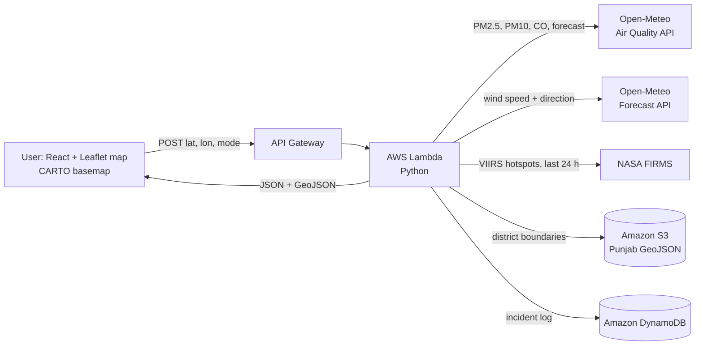
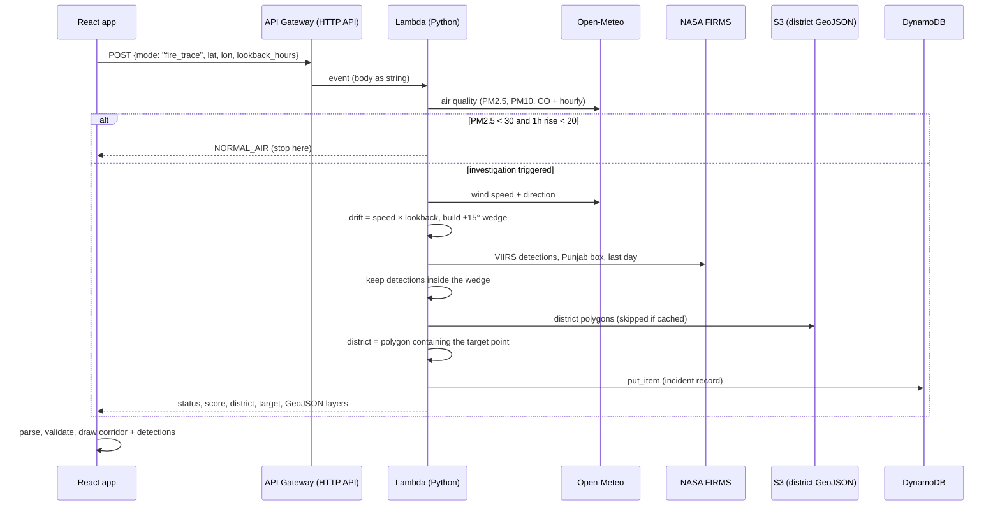

# 🔥 Smoke Scout

**Trace Stubble smoke back to where it probably came from, and help residents decide when to open their windows.**

Smoke Scout takes a single map pin in Punjab, India, reads the local air quality, works out which way the wind has been carrying smoke over the last few hours, draws a search corridor upwind, and cross-checks that corridor against NASA satellite fire detections. It runs serverless on AWS and has two modes: one for everyday residents, one for people investigating stubble burning.

> ⚠️ **Smoke Scout gives estimates, not proof.** The corridor is a rough area to look at. A satellite detection inside it does not prove that fire caused the smoke at the pin. The app says so on screen, and nothing here should be used as evidence for enforcement without independent verification.

---


**Hackathon:** `Environmental Hacks - WeMakeDevs x AWS, 2026` · **Team:** `Terra`

**Landing Page:**


---

## Table of contents

1. [The problem](#the-problem)
2. [What it does](#what-it-does)
3. [Architecture](#architecture)
4. [The data we built ourselves](#the-data-we-built-ourselves)
5. [The detection logic in detail](#the-detection-logic-in-detail)
6. [Request lifecycle](#request-lifecycle)
7. [Backend walkthrough](#backend-walkthrough-backend_startpy)
8. [Frontend walkthrough](#frontend-walkthrough-smoke-scoutsrc)
9. [How the map pin works](#how-the-map-pin-works)
10. [API](#api)
11. [Getting started](#getting-started)
12. [Deploying the frontend on AWS Amplify](#deploying-the-frontend-on-aws-amplify)
13. [Quick walkthrough](#quick-walkthrough)
14. [Technical challenges and decisions](#technical-challenges-and-decisions)
15. [Design principles](#design-principles) · [Limitations](#limitations) · [Future scope](#future-scope)

---

## The problem

Every autumn, paddy-stubble burning across Punjab pushes PM2.5 to hazardous levels across north India. Two groups are poorly served:

- **Residents** can see a number on an app but not an answer: *should I open the windows, and when is the air likely to be better?*
- **Investigators and field teams** see smoke arriving but have no quick way to ask *where could this have come from?* Wind data, satellite fire data and district boundaries all exist, but in different places and formats.

Smoke Scout stitches those together behind one map.

## What it does

### 1. Everyday mode: "When can I open my windows?"


Drop a pin and get a plain-language recommendation based on PM2.5 right now, plus forecast points for the next 6 AM and next 2 PM (morning inversion layers often trap smoke at dawn).

| PM2.5 (µg/m³) | Status | Advice |
|---|---|---|
| < 60 | `GOOD` | Fine for outdoor activity; ventilate the home |
| 60 – 119 | `MODERATE_POOR` | Short activity is fine; sensitive groups limit exertion |
| 120 – 249 | `VERY_POOR` | Avoid outdoor cardio; N95 for walking; windows closed |
| ≥ 250 | `SEVERE_EMERGENCY` | Avoid outdoor exposure; N95 mandatory; HEPA purifier |

The UI compares *now* against the two forecast points and only calls a later time "comparatively better" if it is at least 20% and 10 µg/m³ lower. It never invents an hourly curve or a "best hour".

### 2. Fire-trace mode: "Trace the smoke"


Built for stubble-fire investigation.

1. **Pick a pin** and a look-back window (1, 2, 2.5, 3, 4 or 6 hours).
2. **Air check.** The backend fetches PM2.5, PM10 and carbon monoxide. If PM2.5 is below 30 µg/m³ *and* has not jumped by 20 µg/m³ in the last hour, it returns `NORMAL_AIR` and stops. No biomass influx, nothing to trace.
3. **Wind vector.** It fetches current wind speed and the direction the wind is blowing *from*, then computes drift distance: `speed (km/h) × look-back (h)`. Six hours of 12 km/h wind means smoke could have travelled about 72 km.
4. **Search corridor.** Using great-circle projection, it builds a triangular wedge pointing upwind from the pin: the centre line at the wind-from bearing, with edges at ±15°.
5. **Satellite check.** It pulls the last day of **NASA FIRMS VIIRS (S-NPP, near-real-time)** detections for the Punjab bounding box and keeps those that fall inside the corridor (ray-casting point-in-polygon).
6. **Scoring.**
   - Hotspot inside the corridor → **score 10, `CONFIRMED_STUBBLE_FIRE`**, and the first detection becomes the target point.
   - No hotspot → **score 3, `UNVERIFIED_SMOKE_PLUME`**, and the target is the far end of the corridor's centre line, which is a calculation, not a detection.
7. **District lookup.** The target point is matched against a 23-district Punjab GeoJSON stored in **Amazon S3**, so the response names the probable source district.
8. **Audit log.** Every triggered investigation is stored in **DynamoDB** with a short event ID.

The frontend then draws the corridor, the monitoring location, any satellite detections (with fire radiative power and acquisition time) and the estimated origin point, and keeps reminding the user that this is an approximation.

## Architecture



| Layer | Tech |
|---|---|
| Frontend | React 18, TypeScript, Vite, Leaflet, lucide-react, hand-written CSS (no framework) |
| Basemap | CARTO light and dark tiles on OpenStreetMap data |
| Backend | Python on AWS Lambda behind API Gateway, `boto3`, standard library only for HTTP and geometry |
| Storage | S3 (district GeoJSON, cached in the warm Lambda container), DynamoDB (incident log) |
| Data sources | Open-Meteo (air quality and wind), NASA FIRMS VIIRS (fires) |

## The data we built ourselves

The "which district?" answer does not come from an API. **We created the Punjab district-boundary GeoJSON ourselves** (23 districts) <!-- add how: digitised from official maps / traced in QGIS / simplified from a shapefile, and the source you used -->, and host it in an S3 bucket.

How it is used:

- The file is shaped exactly for what the backend needs: one feature per district, with a name property.
- The Lambda reads it with no GIS libraries (no `shapely`, no `geopandas`), which keeps the deployment package tiny and cold starts fast.
- It supports both `Polygon` and `MultiPolygon` geometries, and tolerates different property names for the district (`NAME`, `district`, `DISTRICT`, `dtname`, `NAME_2`, `name`).
- It is loaded from S3 once and **cached in the warm Lambda container**, so repeat requests skip the S3 round trip.
- If the file is missing or a point falls outside every polygon, the API degrades gracefully to `Punjab (General Region)` or `Border Region / Out of Bounds` instead of failing.

Updating a boundary is just re-uploading the file to S3. No redeploy.

## The detection logic in detail

The geometry is written from scratch in plain Python and mirrored in TypeScript so the frontend can verify what the backend drew.

| Step | Method |
|---|---|
| Drift distance | `d = wind_speed_kmh × lookback_hours` |
| Corridor | Three great-circle projections from the pin (R = 6371 km) along `wind_from − 15°`, `wind_from`, `wind_from + 15°`, joined with the pin into a wedge |
| Estimated origin | The projection along the centre bearing, used when no fire is found |
| Fire matching | Ray-casting point-in-polygon on every FIRMS detection in the Punjab box |
| District | The same ray-casting test against each district polygon from S3 |
| Investigation trigger | `PM2.5 ≥ 30 µg/m³` **or** a rise of `≥ 20 µg/m³` in the last hour |

**Why "wind from" matters.** Weather APIs report the direction the wind blows *from*. Smoke that reaches you came from that side, so the corridor is drawn along the wind-from bearing, not away from it. Getting this backwards puts the corridor where the smoke is *going*.

**Why the cone is 30° wide.** Wind direction wobbles and smoke spreads, so a single line would almost never hit a fire. A ±15° wedge trades precision for a realistic chance of catching the true source.

## Request lifecycle

What happens between pressing **Investigate** and seeing the corridor:



## Backend walkthrough (`backend_start.py`)

One Lambda, one file, standard library plus `boto3` (already in the Lambda runtime). No layers, no zip of dependencies.

**Module scope (runs once per container).** The S3 client, DynamoDB table handle and the district-GeoJSON cache are created outside the handler, so warm invocations reuse them. The first request in a container pays for the S3 read; later ones don't.

**Router (`lambda_handler`).** Reads `event["body"]` when it is a string (API Gateway) or the event itself when it is already a dict (so you can paste plain JSON into the Lambda console test tab). Defaults: `mode = fire_trace`, `lat = 30.2110`, `lon = 74.9455` (Bathinda). Two branches, `citizen` and `fire_trace`, and a `400` for anything else.

**`fetch_air_quality`.** One Open-Meteo call returns the current reading and an hourly PM2.5 series.
- *Current:* `pm2_5`, `pm10`, `carbon_monoxide`.
- *1-hour change:* current value minus the previous hourly value.
- *Forecast points:* it finds "now" in the hourly timeline and scans forward for the next `06:00` and `14:00` entries. That is where the morning-inversion and afternoon-clearing comparison comes from.
- *Trigger:* `investigation_triggered = pm25 ≥ 30 or delta_1h ≥ 20`. This stops the service from burning wind and satellite calls on clean days.
- 4-second timeout; on failure it substitutes placeholder values (see [Limitations](#limitations)).

**`fetch_wind_and_cone`.** Reads `wind_speed_10m` and `wind_direction_10m`, which is the direction the wind blows *from*. Then:
- `dist = speed × lookback_hours`
- `project_point` is the standard spherical destination-point formula (`asin`/`atan2` on a 6371 km sphere), run three times at `bearing − 15°`, `bearing` and `bearing + 15°`.
- The result is a closed ring `[pin, left, right, pin]` plus the centre-line endpoint, returned as GeoJSON coordinates (`[lon, lat]`).

**`check_nasa_fires`.** Calls the FIRMS area API for `VIIRS_SNPP_NRT`, bounding box `73.8,29.5,76.9,32.5`, day range `1`, parses the CSV with `csv.DictReader`, and keeps every detection that `point_in_polygon` places inside the wedge. Each kept hotspot carries `lat`, `lon`, `frp_mw` (fire radiative power) and `acq_time`. Without a real `NASA_MAP_KEY` the function returns nothing rather than calling FIRMS.

**`point_in_polygon`.** Classic ray-casting. It is used twice: fire detections against the wedge, and the target point against each district polygon.

**`match_district`.** Walks every feature in the cached GeoJSON, handles `Polygon` and `MultiPolygon` (every ring), and returns the first district whose polygon contains the point.

**Target point.** If there are detections, the target is the *first* detection returned by FIRMS. Otherwise it is the far end of the wedge's centre line.

**`log_incident_to_dynamodb`.** Writes one item per triggered investigation: `eventID` (8-character UUID prefix), UTC `timestamp`, `mode`, `status`, `confidence_score`, `origin_district`, sensor and target coordinates, `pm25` and `co`. Numbers are stored as strings. The write is wrapped in `try/except`, so a DynamoDB problem never fails the user's request.

**`generate_citizen_advisory`.** Pure function from three numbers (now, 6 AM forecast, 2 PM forecast) to the advice text: now-status and action, window advice, a morning-walk warning at ≥ 150 µg/m³ (caution at ≥ 80), and a suggestion to shift to 2 PM if the afternoon forecast is lower.

**Response contract.**

| `status` | Meaning | Score |
|---|---|---|
| `NORMAL_AIR` | Readings below trigger; no trace run | none |
| `CONFIRMED_STUBBLE_FIRE` | ≥ 1 VIIRS detection inside the corridor | 10 |
| `UNVERIFIED_SMOKE_PLUME` | Air is bad, wind traced, no detection in the corridor | 3 |

The GeoJSON `FeatureCollection` in the response contains up to three layer types: `sensor` (the pin, with PM2.5), `search_wedge` (the corridor polygon, with `drift_km`) and one `nasa_fire_hotspot` point per detection (with FRP).

## Frontend walkthrough (`smoke-scout/src`)

React 18 + TypeScript (strict), bundled by Vite. No router library, no state library, no CSS framework, no map wrapper. The only runtime dependencies are `react`, `react-dom`, `leaflet` and `lucide-react`.

**App shell and routing.** A 15-line hash router (`router.ts`) maps `#/resident`, `#/trace`, `#/about` and the landing page. On every route change the app updates the document title, scrolls to top and moves focus to `<main>`, with a skip link for keyboard users. The pin is lifted into `App` and shared by both journeys, held **in memory only**: nothing is written to browser storage.

**API layer (`src/api`).**
- `client.ts` has a single `call()` that POSTs JSON with a 20-second timeout. It merges the timeout with the caller's own `AbortSignal`, so cancelling and timing out stay distinguishable. It unwraps both API Gateway styles: the plain body, or a `{ statusCode, body: "<json string>" }` envelope.
- `parse.ts` never trusts the response. It uses type guards (`isObj`, `num`, `str`) instead of casts, throws a typed error when a required field is missing, and builds the `Investigation` model by joining the GeoJSON layers with `satellite_fires` (so hotspot geometry comes from one and acquisition time from the other).
- `types.ts` models results as a discriminated union (`kind: 'normal' | 'investigation'`), so the UI cannot render an investigation without handling the "air is fine" case.
- `demo.ts` generates responses in the exact shape of the Lambda's output, and they pass through the same parser. Scenarios: very poor with later improvement, moderate, good, flat, missing forecast, timeout, hotspots in corridor, no hotspot, normal air, service error, malformed response.

**Request state (`useRequest`).** A small hook with four phases (`idle`, `loading`, `success`, `error`). Only one request is in flight: starting a new one aborts the previous, and a late response from an aborted request is ignored, so a slow answer for an old pin can never overwrite a newer one. Moving the pin resets the investigation.

**The map (`PunjabMap.tsx`).** Leaflet is driven imperatively inside React: the map and markers live in refs, and separate effects handle initialisation, the pin, the coverage box, the investigation geometry and the layer toggles, so a state change never rebuilds the whole map.
- Basemap: CARTO light tiles for the resident journey, CARTO dark tiles for the trace journey.
- Click handling uses a 260 ms pending timer so a double-click zoom or the start of a drag cancels a pending pin, which is what lets the permanent / temporary pin logic coexist with normal map gestures.
- The map is bounded to Punjab plus a margin (zoom 6 to 14).
- Corridor styling comes straight from the backend's GeoJSON (filtered by `properties.layer`); the map auto-fits to the pin, wedge and detections.
- Popup text is HTML-escaped. Hotspot popups show FRP, acquisition time in UTC and a reminder that a detection does not prove causation.
- An imperative handle exposes `recenter`, `fitResult` and `focusHotspot` so the side panel can drive the map.

**Geometry on the client (`lib/geo.ts`, `lib/wind.ts`).** The frontend carries its own copy of the great-circle projection and a bearing function. It uses them to **audit the backend**: it measures the corridor's actual direction from the drawn wedge (the midpoint of the two edge points lies on the centre line) and, if the Lambda reports the wind it used, compares the two. Result: `upwind` (correct), `downwind` (corridor inverted), `other` or `unknown`. It also recognises the backend's placeholder wind (75° at 12 km/h) and warns the user.

**Recommendation engine (`lib/advice.ts`).** The same four PM2.5 bands as the backend, plus `deriveVerdict()`, which turns now / 6 AM / 2 PM into a headline, a tone and a comparison. A later time only counts as better if it is ≤ 80% of the current value **and** at least 10 µg/m³ lower, which stops noise from looking like improvement. In the two worst bands, "keep windows closed" always leads and the forecast is context.

**Error handling.** Every failure maps to a typed `ApiError`, and each type gets its own user-facing message:

| Kind | Cause |
|---|---|
| `timeout` | No answer within 20 s |
| `network` | Request never completed (offline, CORS-blocked, DNS) |
| `http` | Gateway returned a 4xx/5xx |
| `service` | Lambda returned `{ "error": ... }` |
| `shape` | Response was not JSON, or missing required fields |
| `config` | App misconfigured |

**Design layer.** Two themes selected per route (`theme-paper` for the resident and about pages, `theme-ink` for the investigation views), driven by CSS custom properties in `tokens.css`. The landing-page hero (`FlowField.tsx`) is generated in code from a deterministic vector field: streamlines, concentration contours and a miniature of the trace geometry, all as inline SVG with `aria-hidden`. It carries no data.

**Accessibility.** Keyboard map control (arrow keys to pan, Enter to place, Escape to cancel), ARIA labels and roles on the map, status regions for loading states, skip link and focus management on navigation, and collapsible legend and layer panels that start closed on phones.

## How the map pin works


The pin is designed so a stray tap never overwrites a deliberate choice:

- **No pin yet:** one click drops the **permanent** pin.
- **Pin already set:** a click only shows a faint, dashed **temporary** pin with a "Use this spot" button. Click that button (or the temporary pin itself) to make it permanent. Clicking elsewhere dismisses it and the permanent pin stays put.
- The permanent pin is also draggable. Other ways to set it: **Use my location**, a city chip, or typed coordinates.
- Keyboard users can pan with the arrow keys and press Enter to drop a pin at the map centre.
- In trace mode, pins outside the satellite search box (29.5–32.5°N, 73.8–76.9°E) are blocked, because a trace there would not be meaningful.

## API

One endpoint, one JSON body.

**Citizen advisory**

```json
POST /  { "mode": "citizen", "lat": 30.2110, "lon": 74.9455 }
```

Returns `advisory.right_now` (status, PM2.5, action, home ventilation) and `advisory.tomorrow_planner` (6 AM and 2 PM forecast, walk advice, better alternative).

**Fire trace**

```json
POST /  { "mode": "fire_trace", "lat": 30.2110, "lon": 74.9455, "lookback_hours": 6 }
```

Returns, for a triggered investigation:

```json
{
  "event_id": "a1b2c3d4",
  "mode": "fire_trace",
  "status": "CONFIRMED_STUBBLE_FIRE",
  "confidence_score": 10,
  "origin_district": "Bathinda",
  "target_coordinates": { "lat": 30.31, "lon": 74.62 },
  "sensor_location": { "lat": 30.2110, "lon": 74.9455 },
  "satellite_fires": [{ "lat": 30.31, "lon": 74.62, "frp_mw": 8.4, "acq_time": "0812" }],
  "geojson": { "type": "FeatureCollection", "features": ["sensor", "search_wedge", "nasa_fire_hotspot"] }
}
```

(Values are illustrative.) If air is normal the response is `status: "NORMAL_AIR"` with the readings. Invalid modes return `400`.

## Getting started

### Prerequisites

- Node.js 18+ and npm
- An AWS account (Lambda, API Gateway, S3, DynamoDB, Amplify - Optional)
- A free [NASA FIRMS MAP_KEY](https://firms.modaps.eosdis.nasa.gov/api/map_key/)
- A GeoJSON of Punjab's districts (23 features)

### 1. Deploy the backend

1. **S3:** create a bucket and upload the Punjab district GeoJSON.
2. **DynamoDB:** create a table with partition key `eventID` (String).
3. **Lambda:** create a Python function from `backend_start.py` (handler `backend_start.lambda_handler`) and set these environment variables:

   | Variable | Purpose |
   |---|---|
   | `DYNAMODB_TABLE` | Incident table name |
   | `S3_BUCKET` | Bucket holding the GeoJSON |
   | `S3_KEY` | Object key of the GeoJSON |
   | `NASA_MAP_KEY` | Your FIRMS key (without it, hotspot checks are skipped) |

4. **IAM:** give the Lambda role `s3:GetObject` on the GeoJSON and `dynamodb:PutItem` on the table.
5. **API Gateway:** expose the function with a `POST` route. Set a timeout of at least 15 seconds, since the function makes up to three outbound calls.

### 2. Run the frontend locally (or [deploy it on Amplify](#deploying-the-frontend-on-aws-amplify))

```bash
cd smoke-scout
npm install
cp .env.example .env      # set VITE_API_URL to your full invoke URL
npm run dev               # http://localhost:5173
npm run build             # typecheck + production build into dist/
```

Leave `VITE_API_URL` empty to run in clearly labelled **demo mode**: a scenario picker walks through every state (severe, moderate, good, hotspot found, no hotspot, normal air, timeout, service error and more) with simulated data. Nothing in demo mode is real.

| Env var | Purpose |
|---|---|
| `VITE_API_URL` | Full API Gateway invoke URL, stage and path included |
| `VITE_DEMO_MODE` | `true` forces demo mode |
| `VITE_API_CONTENT_TYPE` | Defaults to `text/plain` so browsers skip the CORS preflight |
| `VITE_TILE_URL` | Optional custom `{z}/{x}/{y}` tile template |

## Deploying the frontend on AWS Amplify

The frontend is a static Vite app, so **AWS Amplify Hosting** is the quickest way to put it online with HTTPS, a public URL and automatic redeploys on every `git push`. It is how we ran the frontend, and it needs no server of its own.

1. Push the repo to GitHub.
2. In the AWS console open **AWS Amplify → Create new app → Host web app**, choose **GitHub**, and select the repo and branch.
3. If the frontend sits in a subfolder (as `smoke-scout/` does here), tick **"My app is a monorepo"** and set the app root to `smoke-scout`.
4. Amplify detects Vite. Check the build settings match:

   ```yaml
   version: 1
   applications:
     - appRoot: smoke-scout
       frontend:
         phases:
           preBuild:
             commands:
               - npm ci
           build:
             commands:
               - npm run build
         artifacts:
           baseDirectory: dist
           files:
             - '**/*'
         cache:
           paths:
             - node_modules/**/*
   ```

5. Under **Hosting → Environment variables** add `VITE_API_URL` with your API Gateway invoke URL. Vite bakes variables in at build time, so **redeploy after changing it**.
6. Save and deploy. Every push to the branch now rebuilds and publishes the site.

**Notes**

- **Routing:** the app uses hash routes (`#/resident`, `#/trace`), so no rewrite or redirect rules are needed.
- **CORS:** configure it on the HTTP API itself (API Gateway → your API → **CORS**): allow origin `https://<your-branch>.<app-id>.amplifyapp.com` (add `http://localhost:5173` for local dev), methods `POST` and `OPTIONS`, header `content-type`. The gateway then adds the headers to every response, including errors, and ignores any CORS headers the Lambda returns. The app sends `text/plain`, so browsers skip the preflight anyway; if you switch `VITE_API_CONTENT_TYPE` to `application/json`, this gateway config is what makes the preflight pass.
- **Origin must match exactly:** `https://`, no trailing slash, no path. Every Amplify branch or preview has its own domain, so add each one you use.
- **Preview deployments:** turn on Amplify's per-branch or per-pull-request previews to demo changes without touching the main site.
- **Leave `VITE_API_URL` empty** on a preview branch to deploy the demo-mode version, which is useful as a fallback deployment that works without the backend.

## Quick walkthrough

1. Open the app and choose **Check my air**. Drop a pin (or tap **Use my location**) and read the now / 6 AM / 2 PM comparison.
2. Go back and choose **Trace the smoke**. Pick a pin inside the dashed satellite box, for example near Bathinda (`30.2110, 74.9455`, the backend's default location).
3. Set **Look back** to `6 hours` and press **Investigate**.
4. Read the result: the amber wedge is the search corridor, diamonds are NASA detections inside it, and the dashed circle is the estimated point when no fire was found. Click any of them for details.
5. On a clean-air day, the same request returns `NORMAL_AIR`: no investigation is triggered, and that is shown as a normal result.

If the backend is not connected, the app runs in demo mode and lets you step through every scenario.

## Technical challenges and decisions

| Challenge | Decision |
|---|---|
| Naming a district from a coordinate, with no GIS stack on Lambda | Own district GeoJSON in S3, a hand-written ray-casting matcher, and an in-memory cache per warm container. Boundaries update by re-uploading the file |
| Keeping the Lambda small and fast | Standard library plus `boto3` only. Point-in-polygon and great-circle projection are a few lines each, so the function deploys as a single file with no layers |
| "Wind from" versus "wind towards" | Weather APIs report where the wind comes from, so the corridor is drawn along that bearing. The frontend re-measures the corridor's direction from the drawn geometry, so an inverted corridor would be visible |
| Free upstream APIs can be slow or fail | Short timeouts on every call, a 20-second client timeout, typed errors for each failure mode, and detection of the backend's placeholder values so they are flagged instead of presented as real readings |
| A map click must not overwrite a deliberate choice | Permanent and temporary pins, with a 260 ms click timer so double-click zoom and dragging do not drop pins |
| Browser preflight requests on API Gateway | The app sends `text/plain`, a CORS "simple request", and the HTTP API's CORS configuration allows the Amplify origin |
| Smoke at a location is not proof of a fire | Statuses are worded as "satellite hotspot detected within the search corridor" and "possible plume, no matching hotspot". The estimated origin is drawn dashed and labelled a calculation. The internal confidence score is not shown |

## Project structure

```
.
├── backend_start.py          # Lambda: AQ, wind cone, FIRMS check, district match, DynamoDB log
└── smoke-scout/              # React + TypeScript frontend
    └── src/
        ├── api/              # config, types, parse, client (timeout + gateway envelopes), demo
        ├── lib/              # geo (bounds, bearing, projection), advice, wind
        ├── components/       # PunjabMap (Leaflet), LocationPanel, Header, FlowField
        └── pages/            # Landing, Resident, Trace, About
```

## Design principles

- **Careful wording.** `CONFIRMED_STUBBLE_FIRE` is shown as *"satellite hotspot detected within the search corridor"*, and `UNVERIFIED_SMOKE_PLUME` as *"possible plume, no matching hotspot"*. The internal confidence score is never shown to users.
- **Estimates are labelled as estimates.** The origin point is drawn dashed and called "a calculation, not a detection".
- **No silent failures.** The parser handles malformed responses, timeouts, service errors and both API Gateway response styles, and shows a specific message for each.
- **Accessible map.** Keyboard pin placement, ARIA labels, and a legend and layer toggles that start collapsed on phones.

## Limitations

The current version works within what free, open data sources can support:

- **Straight-line wind model.** It uses one current wind reading and assumes constant speed and direction over the whole window. Real smoke curves, slows, disperses and rises. A proper trajectory model (for example HYSPLIT) is the natural next step.
- **Fixed ±15° cone.** The width does not grow with distance or with wind variability.
- **Satellite timing.** FIRMS detections come from a handful of overpasses per day, and small or short-lived fires can be missed entirely. A detection is also from the last 24 hours, not necessarily from the look-back window.
- **Correlation, not attribution.** Fire in the corridor means *possibly responsible*, not *responsible*. Vehicles, industry and non-agricultural burning also emit PM2.5.
- **Fallback values.** If Open-Meteo is unreachable the backend substitutes placeholder readings (PM2.5 142.5, wind 75° at 12 km/h) without flagging it in the response. The UI warns when results exactly match those values.
- **Punjab only, for now.** The satellite search box and the district file cover Punjab. Extending that is the first item of the future scope below.

## Future scope

Smoke Scout is built for Punjab, but the problem it addresses is much bigger than one state, and the design carries over almost unchanged.

### Why this matters beyond Punjab

Stubble burning is a **regional, cross-border problem**. Paddy-residue fires across Punjab and Haryana, driven by the short window between the rice harvest and wheat sowing, are widely cited as a major contributor to the autumn smog over Delhi and the wider NCR, and north-westerly winds carry that smoke hundreds of kilometres. The people who breathe it and the fields that produce it are often in different states, and each side sees only part of the picture:

- A resident in Delhi, Gurugram or Noida sees a bad AQI number but can't tell whether it is **stubble smoke arriving from the north-west** or local sources such as traffic, dust and industry.
- An officer in a Haryana or Punjab district sees fire detections but not **which downwind areas they are affecting**.

A tool that connects *smoke at a location* to *fires upwind of it*, across state lines, answers both questions. That is what makes the idea scale.

### 1. Expand to the full stubble-burning belt: Punjab, Haryana, Delhi-NCR (flagship)

| What changes | Where | Effort |
|---|---|---|
| Widen the satellite search box to cover Haryana, Delhi and western Uttar Pradesh | FIRMS bounding box in `check_nasa_fires` (backend) and the mirrored `COVERAGE` / `MAP_AREA` constants in `lib/geo.ts` (frontend) | Small: a few constants |
| District boundaries for the new states | New GeoJSON in S3, built the same way we built the Punjab one. `match_district` already handles any `Polygon` / `MultiPolygon` and several property names | Medium: mostly data work |
| Longer look-back windows | Today's maximum is 6 hours (about 70 km at 12 km/h). Tracing smoke from the Punjab–Haryana belt to Delhi needs a day or more, which also needs the trajectory model in item 2 | Medium |
| Region config instead of hard-coded values | Move bounding box, GeoJSON key and map bounds into environment variables, so adding a region is configuration rather than code | Small |
| New map presets | City chips for Delhi, Gurugram, Noida, Faridabad, Karnal, Ambala, Kurukshetra, Hisar and more | Small |

Two directions then open up:

- **Upwind tracing for NCR residents:** drop a pin in Delhi, see which Punjab and Haryana districts sit upwind, and whether there are active fire detections there.
- **Downwind impact for field teams:** pick a fire and show which towns and cities its smoke is heading towards.

### 2. Real transport modelling

Replace the single-reading wind cone with multi-hour wind history and trajectory modelling (for example HYSPLIT-style back-trajectories, or hourly wind from a reanalysis or forecast API). Use wind at more than one height, and let the cone widen with distance and wind variability. This is what makes 24-hour, 300-kilometre traces credible, not just 6-hour local ones.

### 3. More and better satellite evidence

- Combine more FIRMS sources (additional VIIRS satellites and MODIS) to cut the gaps between overpasses.
- Match detections to the look-back window by acquisition time, not just the last 24 hours.
- Rank hotspots in the corridor by distance, fire radiative power and time, so the most likely source is highlighted first.
- Add burn-scar and land-cover layers to separate crop fires from other burning.

### 4. Ground truth from monitoring stations

Cross-check the modelled PM2.5 with official station data and low-cost sensors where available, so a trace starts from a measured reading, not only a model value. Sensors near a suspected corridor would also help confirm the smoke is actually moving the way the wind says.

### 5. Alerts that reach people

- Push alerts (SMS, WhatsApp or app) to field officers when a district crosses a PM2.5 threshold or a new confirmed detection appears.
- Health alerts for residents who sign up for their area, with the morning-inversion advice we already generate.
- Built on the incident log we already keep: DynamoDB can feed SNS directly.

### 6. Dashboard for authorities and researchers

Every triggered investigation is already stored in DynamoDB. A dashboard on top of that would show hot districts, time-of-day patterns, week-by-week season trends and how often smoke events match satellite detections. That helps decide where to place enforcement teams, awareness drives and machinery support.

### 7. Reaching farmers and rural users

- Hindi and Punjabi interface.
- Lightweight installable web app that works on weak connections.
- Alongside any detection near a village, point to crop-residue management alternatives so the message is *what you can do instead*, not only *you were detected*.

### 8. Better health guidance

Convert PM2.5 into the national AQI categories residents already know, and tailor advice for children, older adults and people with respiratory conditions. Add an hourly outlook, not only the 6 AM and 2 PM points.

### 9. Open data and API

Publish the incident data and a documented public API so researchers, journalists and other developers can build on it, and so the approach can be reused for other crop-burning regions.

## Data and privacy

Only the pin's latitude and longitude are sent to the backend. Each triggered fire-trace investigation stores the sensor location, estimated target, readings, status and a timestamp in DynamoDB, and the UI says so next to the Investigate button. No accounts, no personal data.

## Acknowledgements

- [Open-Meteo](https://open-meteo.com/) for air-quality and weather data
- [NASA FIRMS](https://firms.modaps.eosdis.nasa.gov/) for VIIRS active-fire detections
- [CARTO](https://carto.com/attributions) and [OpenStreetMap](https://www.openstreetmap.org/copyright) contributors for the basemap
- [Leaflet](https://leafletjs.com/) and [lucide](https://lucide.dev/) for the map and icons

## Team
 `Terra`

| `Pratham Rawat ` | `Backend` | [Linkedin](https://www.linkedin.com/in/pratham-rawat-650bb5364)

| `Advika Kumar` | `Frontend` |  [Linkedin](https://www.linkedin.com/in/advika-k-10613b28b) 

## License

`MIT`
